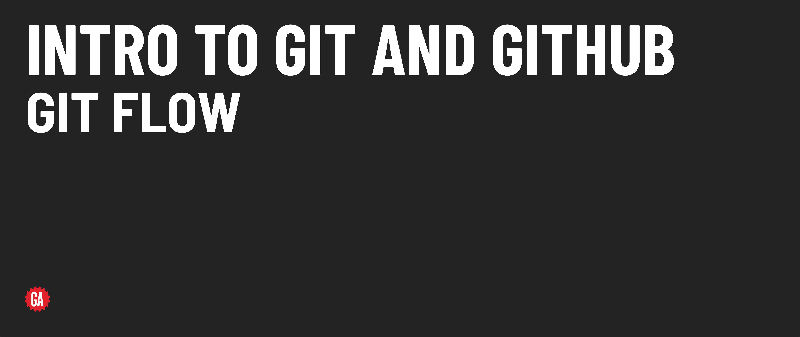
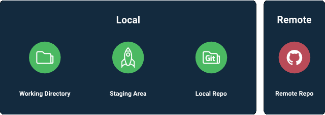

# Intro To Git and GitHub - Git Flow



**Learning objective:** By the end of this lesson, students will be able to stage, commit, and push changes.

## Stage (add)

Command: `git add .`

#### What it does: 
This command adds all files/folders in the current directory to a staging area, where they will be added to the next commit.

#### When and why we use it: 
Use this command after making changes to your code that you want to potentially commit to the local repository. To track changes to files, you must add them to the staging area, where the changes will be committed.

The staging area is an intermediate area where changes to files are stored before being committed to the repository.

The `.` in `git add .` will add all of the files in the directory that we are currently working with. We are also able to add one file at a time, or multiples, by simply writing the file names out when we add:

```bash
git add index.html
```

```bash
git add index.html style.css js/app.js
```

Later on, as we cover GitHub and collaborative coding, it will become more clear why not adding every single file at once can be beneficial. For now, `git add .` will work great!

While this does overly simplify the Git workflow and only gets us so far, while you’re learning it helps to think of your code as a rocket 🚀 - running the `git add .` command puts the entire rocket on the launch pad.

## Commit

The command: `git commit -m "commit message"`

#### What it does: 
This command allows you to provide a checkpoint where you can save the recent changes you've made to your code. It also allows you to enter a message describing the changes that have been made to your code for future reference.

Commit messages should be in the present tense and should describe the changes that the code is making. For example, if a commit fixes a typo in your code, the commit message should be "fix typo", not "fixed typo".

#### When and why we use it: 
Use this command after adding changes to the staging area to commit those changes. Commits provide a list detailing changes that have been made to your code. This allows you (or anyone viewing your repository) to see what code changes have been made over time. It also allows you to revert to previous versions of your code if you end up breaking something and can't figure out how to fix it.

Continuing the rocket analogy 🚀 - committing your code is noting down the current state of the rocket that you've just put in the launch pad. Maybe you added another seat, maybe you managed to shave off some of the hull weight - this commit will help keep track of whatever changed since the previous iteration of the rocket.

## Push 

The command: `git push <remote-name> <remote-branch-name>`

#### What it does: 
This command sends all of the files/directories that have been added/changed since the last commit to a remote repository.

#### When and why we use it: 
Do this immediately after you `git add .` and `git commit -m "Your commit message"`. To get your code on GitHub, you push it from a local repository up to a repository in the cloud (online).

> ♻️ Repeatable Pattern: when working alone, the typical workflow will be: 

-make changes to code-
```bash
git add .
git commit -m “message describing code changes”
git push origin main
```
-repeat-

_For the purposes of this course you will almost always run these 3 commands together._

