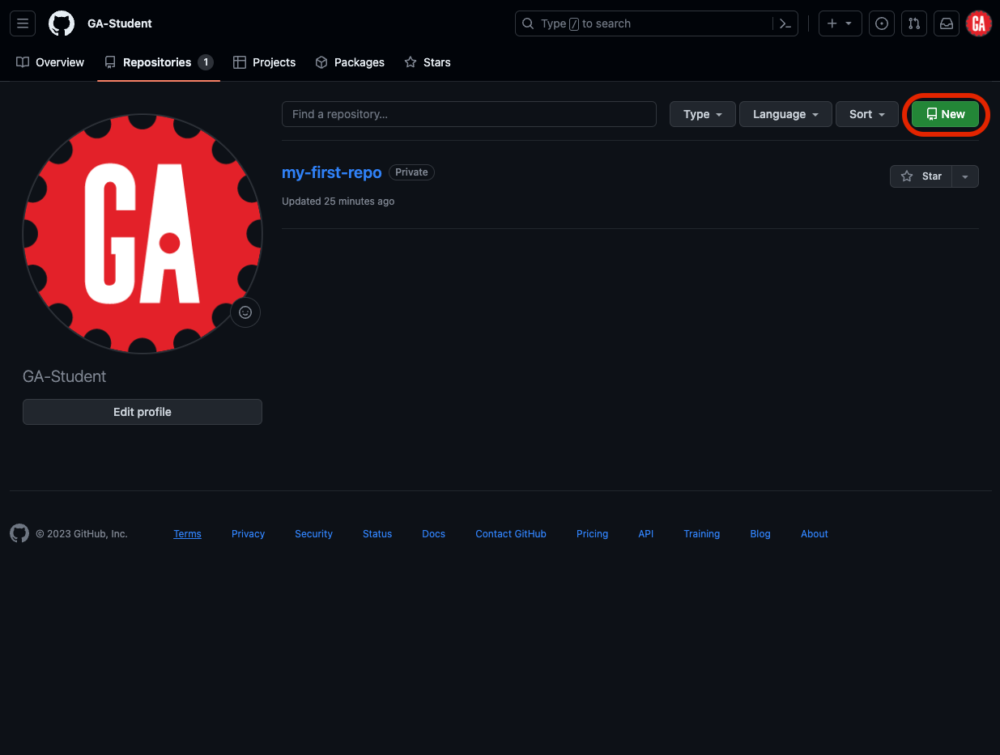
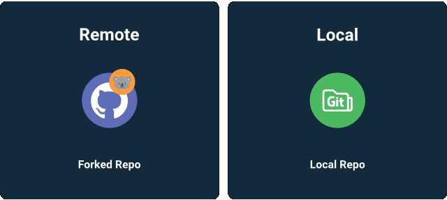

# Intro To Git and GitHub - GitHub Fundamentals


**Learning objective:** By the end of this lesson, students will be able to clone a remote repository and open it in VS Code. 

## Creating a repository

Here are the steps to creating a new repository on GitHub: 

You can click on the repositories tab and select the **New** button: 

Note that if you have not made a repository before, you will not had a repository tab. 



or you can use the dropdown menu: 


Be sure that you select an appropriate name for the repository, and if you plan on sharing it with the instructional team, be sure that it is public:

<placeholder 2, Repo name and Public highlighted>

Be sure that NONE of the following options are selected. (There’s a time and place to use these options, hold off while you’re learning the ropes!):

<placeholder 3, optional show unselected, or consolidate with placeholder2>

When you’ve entered these items, click on ‘Create repository.’

You now have a remote repository on GitHub! 

## Cloning a repository



Cloning allows us to take the current state of a project from a remote repository on GitHub and make a copy onto a local repository on your computer.

You'll use this command anytime you want to make a copy of a project that already exists on GitHub. 

### Step 1: Navigate to the parent directory where you want the cloned directory to exist: 

```bash
cd code/sei
```

### Step 2: Using the URL from GitHub, clone the repository: 

```bash
git clone https://github.com/<original author>/my-project.git
```

> 🚨 When you clone a repository, a directory (matching the repository’s name) will be created automatically. It’s important that you don’t create an additional directory locally, as that may cause issues/confusion later on down the road.

### Step 3: Navigate into the new directory and open in VS Code: 

```bash
cd my-project
code . 
```

> 🚨 When you clone a repository, an origin remote will automatically be set using the URL that you used to clone it. If you’ve cloned a repository that you don’t own (or have write access to), you won’t be able to push changes!

