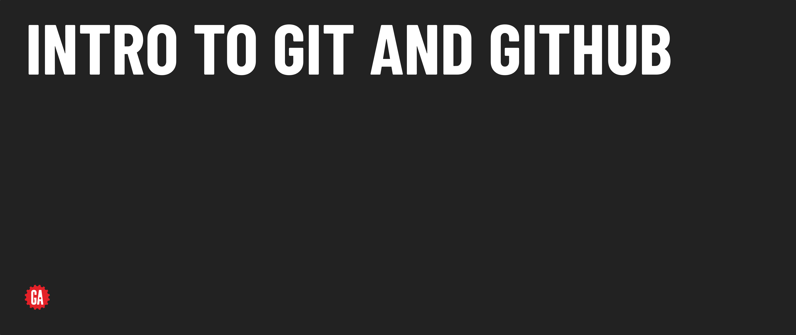

# Intro To Git and Github - Release Notes

## Version 1.0 - Updates from legacy content

This release modularizes the legacy Intro to Git and Intro to GitHub lectures and provides some other minor updates detailed below. Updates are provided here at the module level, but all subsequent updates should be documented at the lesson level.

### Release details

**Additions**

**Changes**

- Screenshots updated to reflect GitHub interface as of 9/24.
- Expand on written lecture material to provide a more straightforward outline for instructors to deliver content with and to provide more thorough written documentation for students.
- Update content to be style guide compliant.

**Removals**

- Green Check section moved to seperate module. 
